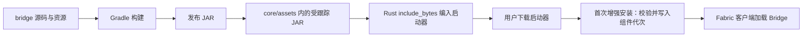

# Bridge 分发设计

状态：**采用“随启动器嵌入”方案**。Bridge 源码和发布 JAR 一起进入 Git；用户下载启动器时无需再单独下载 Bridge。

## 目标

- 新用户安装启动器后，启用增强体验即可获得与启动器协议匹配的 Bridge。
- 首次增强安装仍可按需获取 Minecraft 和 Fabric API；Bridge 本身不增加独立下载步骤。
- Bridge 源码、发布 JAR、Fabric 元数据和 Rust 运行时校验保持可追溯。
- 保留组件代次和摘要校验，使更新失败时可以继续使用上一个已验证组合。

## 选择

Bridge 是启动器的内置客户端组件，不作为普通用户自行安装的模组分发。它与启动器共享本地协议、版本约束和世界生命周期管理；单独下载会引入启动器/模组版本不匹配、下载失败和错误安装目录等问题。当前 JAR 约 28 KB，嵌入成本很小。

启动器发布物包含 Bridge。首次启动增强体验时，启动器按需下载 Minecraft 基础文件和 Fabric API，然后把二进制内的 Bridge 写入增强组件代次目录并启动该代次。普通模式不安装或加载 Bridge。



## 仓库内容

Git 必须保留以下输入和发布产物：

- `bridge/src/`、`bridge/build.gradle`、`bridge/gradle.properties`、`bridge/settings.gradle`
- `bridge/gradlew`、`bridge/gradlew.bat` 和 `bridge/gradle/wrapper/`
- `bridge/package.sh`
- `core/assets/deepslate-bridge-<version>.jar`

`bridge/.gradle/`、`bridge/build/` 和 `bridge/run/` 是缓存或运行输出，应继续忽略。打包 JAR 位于 `core/assets/`，不要把它移到被忽略的 Gradle 输出目录。

每次提交 Bridge 源码或资源改动时，都应把重新构建后的 `core/assets/` JAR 一起提交，避免仓库版本出现无法复现的内嵌二进制。

## 构建与发布顺序

Cargo 编译不会自动运行 Gradle。Bridge 源码或资源有变化时，先从仓库根目录执行：

```bash
./bridge/package.sh
cargo test -p deepslate-core --lib
cargo build --release --workspace
```

`package.sh` 重建 JAR 并覆盖 `core/assets/` 中的副本；随后 Cargo 将该副本编入启动器。开发环境可用 `DEEPSLATE_GRADLE_BIN` 指定 Gradle 可执行文件，并用 `DEEPSLATE_GRADLE_OFFLINE=1` 请求离线构建。

发布检查应确认：

1. Java 25 与 Gradle wrapper 可用，Bridge 构建成功。
2. 源码改动后重新生成并提交 JAR；只改了启动器时，构建仍使用当前提交中的 JAR。
3. Rust 内嵌组件测试确认 JAR 的 `id`、版本、Minecraft/Fabric API 约束与启动器常量一致。
4. `core/assets` 中的 JAR 与 Gradle 构建输出一致；发布二进制是在该同步之后编译的。
5. 发布产物覆盖对应目标平台；Bridge JAR 本身与操作系统无关，启动器和 Java 运行时仍须按平台分别打包/验证。

`bridge/package.sh` 是同步入口；建议后续 CI 在构建后检查仓库没有因打包而产生未提交的 `core/assets` 差异。Gradle wrapper 的发行包 SHA-256 目前尚未固定，纳入正式发布流水线前应补上校验并缓存所需依赖。

## 版本与兼容约束

目前 Bridge 版本、JAR 文件名和运行时校验版本分别出现在 `bridge/build.gradle`、`bridge/src/main/resources/fabric.mod.json`、`core/src/enhanced.rs`。升级 Bridge 时同步这些值、重新打包 JAR，并运行内嵌组件校验；不要只替换其中一处。

`PROTOCOL` 是启动器与模组之间的消息协议版本，与 Bridge 的语义版本分开管理。只改 UI 文案或 Fabric hook 且消息形状不变时可不升协议；新增、删除或改变消息语义时，两端同步升级协议号，并覆盖握手、命令关联和状态回报的兼容测试。

当前增强运行时锁记录 Bridge 版本、协议号和 JAR 摘要。更新以新组件代次落盘，校验成功后再切换锁；失败时沿用最后一个可验证代次。Bridge 被编入新启动器后，客户端会在下一次增强安装/更新时使用新包；旧启动器不会从网络静默替换自己的 Bridge。

## 网络与离线行为

- Bridge 从启动器二进制内取得，不单独请求网络。
- Minecraft 和 Fabric API 由启动器按其各自的官方元数据/校验流程获取，不随 Bridge JAR 一起捆绑。
- 已有完整增强组件代次可离线复用；首次安装仍可能需要 Minecraft/Fabric API 缓存或网络。
- 只有在未来需要脱离启动器版本独立发布 Bridge 时，再设计受签名或可信摘要保护的组件清单和更新入口；当前不增加独立下载 UI。

## 尚需补齐

- Windows 增强会话仍按现状暂停；嵌入 JAR 是跨平台的，但 Windows 凭据文件 ACL、启动/安装和实际游戏生命周期尚未验收。
- macOS 尚无实机证据。
- 没有自动 CI 发布流水线；当前通过 `package.sh` 和 Rust 测试手动保持源码/JAR/内嵌约束一致。
- 当前增强实现固定 Minecraft 26.3；“26.3+”是最低版本声明，后续游戏版本须先更新并验证 Fabric API、Bridge 元数据和 Mixin 目标。
