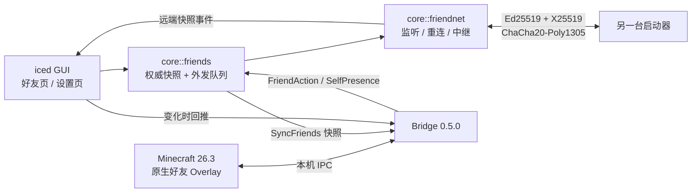

# 去中心化好友管理设计（后端主导）

日期：2026-10-29。状态：**已实现首版，待双机/26.3 实机验收。**
目标平台：Minecraft Java 26.3 + Fabric + Deepslate Bridge 0.5.0。

## 1. 结论与范围

好友关系由 `deepslate-core` 的**后端**持有，而不是交给 Minecraft 进程或某个中心服务器：

- 每个账户一个 Ed25519 身份，好友关系变更全部签名后落盘。
- 启动器之间直接 TCP 连接；直连失败时，可以由共同好友单跳中继已签名的申请。
- Minecraft 26.3 原生好友界面只读启动器快照；游戏内操作、在线状态通过 Bridge 回传后端。
- 没有中心账号服务器、中心好友库或中心在线状态服务。两台机器同时离线时，关系仍然只存在于双方本地。

明确不在首版范围：

- 同账户多设备共享身份（复制 `<root>/config/friends/keys/` 可手动实现，但不做云同步）。
- 好友图直连的 NAT 穿透（STUN/TURN/打洞）、DHT、自动公网发现；世界 P2P 隧道是独立模块，见 `core/src/tunnel.rs`，不改变好友图的直连边界。
- 用 Mojang 登录为“好友身份 = Minecraft 正版账号”提供密码学证明。
- 离线消息长期存储、群组、聊天、屏蔽/举报。
- 后台常驻守护进程：好友网络随启动器进程运行；启动器退出后不再监听，好友在 90 秒超时后看到离线。

## 2. 组件与数据流



| 模块 | 职责 |
| --- | --- |
| `core/src/friends.rs` | 身份、DL2 好友码、快照/外发队列/墓碑、关系状态机、动作入口 |
| `core/src/friendnet.rs` | 安全握手、加密帧、监听/重连、连接去重、心跳、中继、在线状态 |
| `core/src/bridge.rs` | 26.3 本机 IPC；转发游戏内好友动作与 `SelfPresence` |
| `core/src/tunnel.rs` | 世界 P2P 隧道：Iroh QUIC、`DSR-` 票据、好友身份挑战认证、端口转发 |
| `core/src/secure_fs.rs` | 跨平台私有文件/目录：Unix 0700/0600，Windows owner-only DACL |
| `bridge/…/DeepslateFriendsService.java` | 游戏内 `FriendsService` 内存镜像；返回 presence、上报自身状态 |
| `gui-iced` | 好友页、端口/对外地址设置、网络启停、事件回灌游戏 |

## 3. 身份与好友码

### 3.1 身份

每个档案 UUID 对应一个长期 Ed25519 身份：

```text
<root>/config/friends/keys/<profile-uuid>.json   # PKCS#8, 0600
<root>/config/friends/<profile-uuid>.json        # 好友快照, 0600
```

- 私钥只在后端读取；Bridge 和 GUI 都拿不到。
- 身份缓存按**密钥文件完整路径**索引，切换根目录不会复用旧根目录的密钥。
- 身份丢失等于换号：旧好友需要重新交换好友码。

### 3.2 DL2 好友码

```text
DL2-<64 位十六进制 Ed25519 公钥>-<base64url(对外地址 host:port)>
```

- 公钥是信任锚；地址段只是“最近一次已知可达地址”。
- 地址段为空也合法：只能等待对方连入，或经共同好友中继。
- 旧版 `DL1-…` 没有公钥和地址，只能本地保存；联网操作会明确报错，要求重新复制 DL2 码。
- 游戏内输入框已从 64 字符放宽到 512；Java 侧只把公钥段转大写，**地址段保持大小写**（base64url 大小写敏感）。

## 4. 关系状态机与收敛

### 4.1 记录

`FriendEntry` 的关键字段：

```text
profile_id   对端声明的 Minecraft 档案 UUID（显示/Bridge 用）
name         对端声明的显示名（签名覆盖，但不等于 Mojang 正版证明）
key          对端 Ed25519 公钥（真正确认身份的字段）
endpoint     最近已知 host:port
presence     由对端直连或单跳中继的 presence 更新
revision     关系高水位：max(当前毫秒时间戳, 本地历史高水位 + 1)
updated_by   高水位对应的公钥，用于确定性比较
request_id   当前申请的一次性 ID
source       direct / relay / local
```

快照同时保存 `friends`、`incoming_requests`、`outgoing_requests`、`outbox`、`tombstones`。

### 4.2 动作

| 动作 | 本地效果 | 网络效果 |
| --- | --- | --- |
| 添加 | 写入 outgoing，生成签名 `friend_request` | 入队，直连或中继 |
| 接受 | incoming → friends | 入队 `friend_accept` |
| 拒绝 | 移除 incoming，写墓碑 | 入队 `friend_decline` |
| 撤回 | 移除 outgoing，写墓碑 | 入队 `friend_cancel` |
| 删除 | 移除 friends，写墓碑 | 入队 `friend_remove` |
| 设置 | 更新 enabled / allow_requests | 不发送 |

- 双方同时互加时自动成为好友（交叉申请），并补发 `friend_accept`。
- 所有入站事件必须 revision 高于本地高水位；相同或更低视为重放/过期。
- 删除/拒绝/撤回会留下 `tombstone`，阻止延迟到达的旧 accept/request 复活关系。
- 新申请可以覆盖旧的 pending（revision 更高时），但不会产生同一公钥的重复条目。
- 申请正文包含目标公钥 `to`；中继和接收方都校验，防止把 A 的申请投递给无关的 C。

### 4.3 外发队列

`outbox` 中每条消息保存：

```text
id, peer_key, kind, body, signature, signed_at, created_at,
attempts, next_attempt, via
```

- 签名在入队时完成，之后重试/中继不再改写内容。
- 只有目标公钥对应的节点发来的 `ack {op, status}` 才能移除条目；其他好友/中继不能代删。
- 目标拒绝申请时，发送方同时移除 outgoing 并写墓碑。
- 未送达条目保留最多 30 天，启动时清理过期项。

## 5. 传输与安全

### 5.1 帧

- TCP，4 字节大端长度 + 密文；单帧上限 64 KiB。
- 握手帧使用 2 字节长度，上限 8 KiB。
- 所有后继帧使用 ChaCha20-Poly1305，每个方向独立的 64 位计数器作为 nonce。
- 连接空闲 20 秒发 ping；75 秒无入站帧断开；每 12 秒尝试重连。

### 5.2 三轮握手

```text
A -> B  H1: key_A, eph_A, rand_A, Sig_A("DSF1-H1" || key_A || eph_A || rand_A)
B -> A  H2: key_B, eph_B, rand_B, Sig_B("DSF1-H2" || 双方 key/eph/rand)
A -> B  H3: Sig_A("DSF1-H3" || 双方 key/eph/rand)
```

- H1/H2/H3 的签名覆盖双方静态公钥、临时公钥和随机数，防止反射、篡改和降级。
- 双方用 X25519 计算共享秘密，HKDF-SHA256（salt = rand_A || rand_B，info 含双方公钥）派生 64 字节，分成两个方向的 AEAD key。
- 连接建立后，Wire 消息另有 Ed25519 签名；传输层加密与关系消息签名是两层独立保护。
- 单进程最多同时处理 64 个握手；握手超时 6 秒，连接超时 8 秒。

### 5.3 同时连接去重

双方可能同时主动连接。规则：**公钥较小的一方发起的连接是 preferred**。

- 两端对哪条连接 preferred 的判断一致。
- 已有 preferred 时拒绝 non-preferred；没有 preferred 时临时保留 non-preferred，等 preferred 到达后替换。
- 这样同时连接最终只保留一条双方都认可的 TCP 连接。

## 6. 中继（单跳）

```text
A --(加密)--> C --(加密)--> B
```

- A 直连 B 失败后，把 `relay {to: B, inner: 已签名消息, hops: 0}` 发给当前在线好友；inner 可以是申请、接受/删除等关系消息，也可以是在线状态。
- C 只在以下条件全部满足时转发：C 与 A 是好友、C 与 B 是好友、`hops == 0`、inner 的申请 `to == B`。
- C 用**自己的身份**重新包一层 `relay` 给 B；inner 仍是 A 的原始签名，C 不能伪造或改写关系。
- B 的 ack 通过 `relay_ack` 回到 C，再以同样的单跳方式回到 A。
- 不做多跳：`hops > 0` 的转发直接丢弃，避免环路和不可控的元数据扩散。

**安全边界**：直连是端到端加密；中继只能看到“谁在什么时候想联系哪个公钥”以及 inner 明文内容。中继不能伪造签名，但能读取申请中的显示名和地址。首版接受这一权衡并在 UI 中说明。

## 7. 在线状态与 Minecraft 26.3

### 7.1 状态语义

```text
online / playing_offline / playing_realms / playing_server /
playing_hosted_server / offline
```

- 好友状态优先通过**已认证直连**发送，每 30 秒一次。
- 没有直连的好友（典型是双方都在 NAT 后）每 120 秒经最多 3 个在线共同好友单跳中继；inner 仍是本人签名，接收方只在对方是好友时接受。中继因此能看到 presence 元数据，这是为 NAT-only 好友保留在线状态而接受的权衡。
- 90 秒没有心跳/状态后自动标记 offline。
- 服务优雅停止时向所有在线好友发送一次 `offline`，给连接任务 250ms 冲刷时间；进程崩溃则由 90 秒超时兜底。
- 启动器启动时会把上次崩溃遗留的 `playing_*` 重置为 `online`，等待游戏重新上报。

### 7.2 Bridge 0.5.0 的双向路径

1. Rust 把权威快照通过 `SyncFriends` 发进游戏。
2. `DeepslateFriendsService.replaceFromLauncher` 更新好友/申请/presence 镜像。
3. 游戏原生好友列表通过 `getFriendData` 读取；`presence(status)` 用快照生成 `PresenceResponse`。
4. 原生 `PresenceHandler` 把自己的 `PresenceStatus.name()` 传给 `presence(status)`；Bridge 通过 `SelfPresence` 事件回传。
5. Rust `presence_from_authlib` 映射到稳定状态，更新自身快照并唤醒好友网络广播。
6. 游戏内添加/接受/拒绝/删除操作进入 `FriendAction`，由后端校验、落盘、入队，再把新快照推回游戏。

协议版本仍为 2；`SelfPresence` 是向后兼容的新增事件，旧 Bridge 不会发送，新 Bridge 配旧 Rust 也会被忽略。

## 8. 配置与目录

`config.json` 新增：

```json
{
  "friend_port": 27731,
  "friend_advertise": ""
}
```

- 默认监听 `0.0.0.0:27731`。
- `friend_advertise` 留空时探测本机局域网 IPv4 并拼上端口；可填 `example.com:27731` 或 `[::1]:27731`。
- 公网直连需要路由器端口转发；无法直连时依赖共同好友中继。
- 端口被占用会明确报错并写入 `network.error`，不会静默改端口（否则已分享的好友码会失效）。
- 修改端口/对外地址后保存设置会重启好友网络；在线好友会短暂重连。

## 9. 威胁模型与已知限制

| 风险 | 首版处理 |
| --- | --- |
| 陌生人扫端口/刷申请 | `enabled` + `allow_requests` 双重开关；申请需接受；连接数上限 64 |
| 伪造好友身份 | DL2 公钥是信任锚；连接握手校验期望公钥；关系消息逐条签名 |
| 中继冒充/改写 | inner 保持原签名；只允许单跳；目标 `to` 校验 |
| 重放旧申请/旧删除 | revision 高水位 + tombstones |
| Ack 伪造 | 只有 outbox 目标公钥的 ack 生效 |
| 显示名冒充正版玩家 | **未解决**：显示名/UUID 只是对端签名声明，未绑定 Mojang 账号；好友码才是信任锚 |
| NAT/公网不可达 | 好友图用端口转发或共同好友中继；世界 P2P 隧道独立使用 Iroh 的 STUN/UPnP/Relay |
| 同账户多设备 | 每套安装独立密钥；不支持自动同步 |
| 中继可读申请/presence 元数据 | 已知并文档化；直连为端到端加密，中继只做单跳 |
| 自定义密码学 | 使用 ring 的 Ed25519/X25519/HKDF/ChaCha20-Poly1305，但握手是本项目自定义组合，建议外部审计 |
| Windows 文件 ACL | **代码已实现**：Bridge 会话与好友密钥统一走 `secure_fs` 的 owner-only DACL；仍需 Windows + Minecraft 实机验收 |
| 写入放大 | 每次可见状态变更/连接变更都会原子写快照并 fsync；好友很多时需后续批处理 |
| 系统时钟严重偏差 | revision 以毫秒时间戳为下界；时钟大幅超前的一方会让过旧的申请被判定过期。建议保持系统时间同步 |

## 10. 验证与后续

已通过的自动化证据：

- `cargo test -p deepslate-core --lib -- --test-threads=1`：144 passed / 6 ignored（Windows 实机，2026-10-29）。
- `cargo test -p gui-iced --bin deepslate-iced`：28 passed。
- `cargo check --workspace --release` 通过（仅既有 `auth.rs` 命名 warning）。
- 新增覆盖：
  - invite code/endpoint 校验；
  - 握手成功 + 错误期望身份拒绝；
  - 加密帧往返、消息签名篡改拒绝；
  - 真实监听端口上，已认证节点完成「申请 → ack → 本地接受 → accept 外发 → presence → 删除」全链路；
  - 双账户「申请 → 接受 → presence → 删除 → 旧申请重放」状态机；
  - 错误目标公钥的申请被拒绝；
  - 旧配置缺省好友字段仍可加载；
  - P2P 隧道：公开票据、仅好友房间的 DL2 挑战、错误身份拒绝、票据 nonce/签名绑定；
  - Windows：`secure_fs` owner-only DACL、Bridge 握手与受管会话。
- Bridge：`./gradlew --offline build` 成功；内嵌 `core/assets/deepslate-bridge-0.5.0.jar` 与 `bridge/build/libs/` SHA-256 一致。

尚未完成、需要实机证据：

1. 两台机器（同 LAN + 公网端口转发 + 不可直连经第三方中继）完整添加/接受/在线/删除。
2. 26.3 原生好友 Overlay 在真实客户端中的列表、presence、申请确认和按钮结果。
3. 游戏内输入 DL2 码（长文本、大小写、粘贴）与 512 字符输入框行为。
4. 启动器崩溃/断网/重连、好友网络端口被占用、根目录切换后的行为。
5. Windows/macOS 文件权限与路径：Windows IPC/ACL 代码与单测已完成，但 Java 25 + 26.3 + Bridge 实机仍未验收；macOS 未验收。

后续优先级：

1. 双机实机闭环与 26.3 Overlay 验收（最高）。
2. 好友图的 NAT 穿透/可选公网 rendezvous（不改变“无中心好友数据”的边界）。
3. 身份导出/导入，支持同账户多设备。
4. 中继端到端加密（需要静态 X25519 密钥或等价方案）。
5. 快照写批处理、presence 增量更新、连接级速率限制。
6. Windows 实机与跨平台打包验收。
